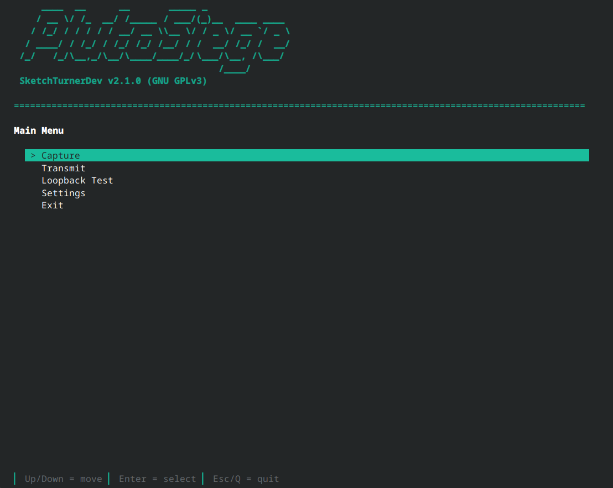
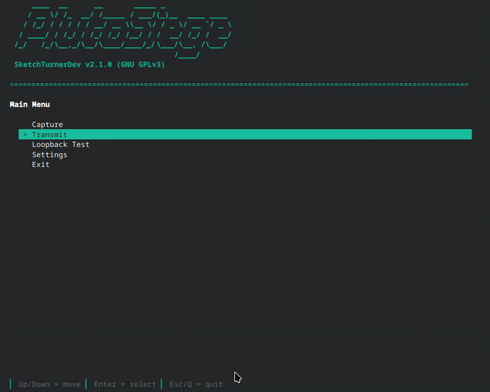

<h1 align="center">PlutoSiege</h1>

<p align="center">
  <strong>RF Capture & Replay Tool for PlutoSDR</strong>
</p>

<p align="center">
  <a href="https://pypi.org/project/pluto-siege/"></a>
  
  <a href="https://github.com/SketchTurnerDev/pluto_siege/blob/main/LICENSE"></a>
  
  
</p>

<p align="center">
  
</p>

> **REGULATORY DISCLAIMER**  
> RF transmission is regulated by local authorities. Replay only signals you own or are permitted to transmit, into a dummy load or at the lowest power required.

## About

**PlutoSiege** is a terminal and command-line tool for recording and replaying short RF bursts at 433 MHz, 868 MHz, and nearby frequencies from car remotes, garage doors, doorbells, and wireless sensors.

Built for ADALM-Pluto SDR hardware, it saves captures in the standard SigMF format so recordings can be opened directly in URH, IQEngine, GNU Radio, or Inspectrum.

### Hardware Compatibility
Supports official Analog Devices ADALM-Pluto Rev. B and Rev. C boards as well as compatible AD9363 and AD9361 clones such as Pluto Nano, Pluto Plus, and custom PlutoSDR hardware.

## Features

- **Single & Continuous Capture**: Capture single RF bursts or enable **Auto capture** (`--auto-capture true`) to loop continuously and save numbered multi-burst recordings with collision-safe filenames.
- **Level Metering**: Real-time dBFS level meter with saturation (`SAT!`) warning.
- **Threshold Detection**: Automated noise floor estimation (with optional periodic recalibration for mobile capture) or manual threshold setting.
- **Pre-Trigger Buffer**: Keeps a ring buffer of history before trigger so preambles are not missed.
- **SigMF Format**: Saves `.sigmf-meta` and `.sigmf-data` pairs in a configurable recordings directory.
- **GPS Geotagging**: Records precise coordinates in SigMF metadata via `gpsd` and displays geotags during replay.
- **Digital Loopback Test**: Built-in internal digital BIST loopback test (at 1 GHz) to check hardware health and SNR without external antennas.
- **Full CLI & Headless Mode**: Launch any mode or override any setting from the command line, list available recordings, or run completely headless without curses.
- **Linux Native**: Built and optimized specifically for Linux environments (supports all major distribution families: Debian-based, RPM-based, Arch-based, etc.).

## Installation

### 1. System Drivers
Install the required IIO system drivers for your distribution family:

**Debian-based:**
```bash
sudo apt update && sudo apt install -y libiio0 libiio-dev libiio-utils
```

**RPM-based:**
```bash
sudo dnf install -y libiio python3-iio libiio-utils
```

**Arch-based:**
```bash
sudo pacman -S libiio
```

### 2. Optional: GPS Support
If you plan to use GPS geotagging for SigMF recordings, install the `gpsd` daemon and tools:

**Debian-based:**
```bash
sudo apt install -y gpsd gpsd-clients
```

**RPM-based:**
```bash
sudo dnf install -y gpsd gpsd-clients
```

**Arch-based:**
```bash
sudo pacman -S gpsd
```

> **Note:** Configure and start the `gpsd` service according to your specific GPS receiver hardware (USB dongle, UART module, Bluetooth, or virtual source) so that it listens on `127.0.0.1:2947`. Once running, enable GPS in PlutoSiege **Settings** (`Enable GPS (gpsd): yes`) or via CLI (`--enable-gps true`).

### 3. Install & Run PlutoSiege

#### Option A: Via pip / pipx (Recommended)
Install directly from PyPI:
```bash
pipx install pluto_siege
# or: pip install pluto_siege
```

Launch from any terminal:
```bash
pluto_siege
```

#### Option B: From Source
Clone the repository and install dependencies:
```bash
git clone https://github.com/SketchTurnerDev/pluto_siege.git
cd pluto_siege
pip install -r requirements.txt
```

Launch via the main script:
```bash
python pluto_siege.py
# or: python -m pluto_siege
```

## Demo

<p align="center">
  
</p>

## Application Menu

### 1. Capture
Listens for incoming RF bursts on the configured receiver frequency (`rx_freq`).
- Captures a single burst by default, or loops continuously (numbering saved bursts `[#1]`, `[#2]`, ... until stopped with `Esc` / `Q` in TUI or `Ctrl+C` in headless mode) when **Auto capture** (`--auto-capture true`) is enabled.
- Real-time dBFS level meter with saturation (`SAT!`) warnings.
- Automated noise floor estimation or manual threshold detection.
- Pre-trigger history ring buffer to preserve signal preambles.
- Saves captures as standard SigMF (`.sigmf-meta` and `.sigmf-data`) pairs with optional GPS geolocation tags.

### 2. Transmit
Browse and replay saved SigMF recordings from the configured recordings directory (`records_dir`).
- Displays recorded timestamp, center frequency, sample rate, sample count, and GPS coordinates.
- Replays signals via the PlutoSDR transmitter at the exact frequency (`core:frequency`) and sample rate (`core:sample_rate`) stored in `.sigmf-meta`.
- In-place deletion of unwanted recordings (`D` or `Delete`).

### 3. Loopback Test
Internal hardware diagnostic to verify the SDR transceiver and USB/DMA pipeline.
- Enables the AD936x internal digital BIST loopback (`loopback = 1`) at 1 GHz without transmitting over the air.
- Calculates received Signal-to-Noise Ratio (SNR) to confirm hardware health.

### 4. Settings & CLI Parameters
Configures radio parameters, trigger behavior, GPS integration, and interface preferences. All settings can be edited interactively in the TUI **Settings** screen or passed via command-line flags.

| Flags / Parameter | Type | Default | Description |
| :--- | :--- | :--- | :--- |
| `--pluto-uri`<br>`--pu` | `str` | `usb:` | PlutoSDR `libiio` context URI (`usb:`, `usb:1.4.5`, `ip:192.168.2.1`, `local:`). |
| `--rx-freq`<br>`--rf` | `int` | `433.92M` | Receiver center frequency in Hz; supports `k`/`M`/`G` suffixes and bare MHz shorthand (`70M - 6G`; e.g. `433`, `868`). |
| `--sample-rate`<br>`--sr` | `int` | `2.1M` | Sample rate in SPS; supports `k`/`M` suffixes (`521k - 61.44M`). |
| `--rf-bandwidth`<br>`--rb` | `int` | `0` | Analog RF filter bandwidth in Hz, or `0`/`auto` to follow `--sample-rate`; supports `k`/`M` suffixes (`0` or `200k - 56M`). |
| `--rx-gain`<br>`--rg` | `float` | `15.0` | Manual RX hardware gain in dB (`-10.0 .. 74.5`). |
| `--tx-gain`<br>`--tg` | `float` | `0.0` | Manual TX hardware gain in dB (`-89.75 .. 0.0`). |
| `--tx-repeats`<br>`--tr` | `int` | `1` | Number of consecutive burst transmissions per replay (`1 .. 100`). |
| `--auto-capture`<br>`--ac` | `bool` | `false` | Enable continuous multi-burst capture loop (`true` or `false`). |
| `--auto-threshold`<br>`--at` | `bool` | `true` | Enable automatic noise floor threshold detection (`true` or `false`). |
| `--auto-trigger-margin`<br>`--atm` | `float` | `8.0` | Trigger margin above noise floor in dB (`1.0 .. 30.0`; unused when `--auto-threshold` is `false`). |
| `--auto-recal-seconds`<br>`--ars` | `float` | `0.0` | Periodic noise floor recalibration interval in seconds while listening, or `0` to disable; supports `ms`/`s` suffixes (`0.0 .. 600.0`; unused when `--auto-threshold` is `false`). |
| `--manual-threshold`<br>`--mt` | `float` | `-30.0` | Fixed trigger threshold in dBFS (`-120.0 .. 0.0`; unused when `--auto-threshold` is `true`). |
| `--pre-trigger-buffers`<br>`--ptb` | `int` | `2` | Number of pre-trigger history buffers kept in memory (`1 .. 50`). |
| `--min-burst-seconds`<br>`--mbs` | `float` | `0.0` | Minimum active burst duration in seconds to filter short noise spikes, or `0` to disable; supports `ms`/`s` suffixes (`0.0 .. 5.0`). |
| `--silence-seconds`<br>`--ss` | `float` | `0.8` | Continuous silence duration in seconds to stop recording; supports `ms`/`s` suffixes (`0.01 .. 10.0`). |
| `--max-post-trigger-seconds`<br>`--mpts` | `float` | `4.0` | Maximum recording duration in seconds after trigger; supports `ms`/`s` suffixes (`0.1 .. 30.0`). |
| `--rx-buffer-size`<br>`--rbs` | `int` | `32768` | DMA receive buffer size in samples (`1024 .. 1048576`). |
| `--enable-gps`<br>`--eg` | `bool` | `false` | Enable GPS geolocation tagging via `gpsd` daemon (`true` or `false`). |
| `--gpsd-host`<br>`--gh` | `str` | `127.0.0.1` | `gpsd` daemon hostname or IP address (unused when `--enable-gps` is `false`). |
| `--gpsd-port`<br>`--gp` | `int` | `2947` | `gpsd` daemon TCP port (`1 .. 65535`; unused when `--enable-gps` is `false`). |
| `--records-dir`<br>`--rd` | `str` | `./recordings` | Directory path for saving and loading SigMF recordings (`~/.pluto_siege/recordings` when installed via `pip`/`pipx`). |
| `--enable-sound`<br>`--es` | `bool` | `true` | Enable acoustic sound effect cues (`true` or `false`). |
| `--enable-mouse`<br>`--em` | `bool` | `true` | Enable terminal mouse support in the TUI (`true` or `false`). |

### CLI-Only Options

| Flags | Description |
| :--- | :--- |
| `--capture`<br>`-c` | Start in Capture mode. |
| `--transmit`<br>`--tx` | Start in Transmit mode (pass a recording `#` from `--list`, `.sigmf-data` path, `'latest'`, or omit in TUI). |
| `--loopback`<br>`--lb` | Run the internal digital Loopback Test. |
| `--list`<br>`-l` | List available SigMF recordings in `records-dir` and exit. |
| `--show-config`<br>`--sc` | Show current configuration and exit. |
| `--headless`<br>`--hl` | Run in console text mode without the curses TUI (outputs plain logs without colors or live meter when redirected to a file/pipe; supports `NO_COLOR` / `FORCE_COLOR`). |
| `--save`<br>`-s` | Persist CLI setting changes to `settings.json`. |
| `--reset`<br>`-r` | Reset configuration to defaults and save to `settings.json`. |
| `--version`<br>`-v` | Show program version and exit. |
| `--help`<br>`-h` | Show help message and exit. |

## License

Distributed under the **GNU General Public License v3.0** (GPL-3.0). See [`LICENSE`](https://github.com/SketchTurnerDev/pluto_siege/blob/main/LICENSE) for details.
